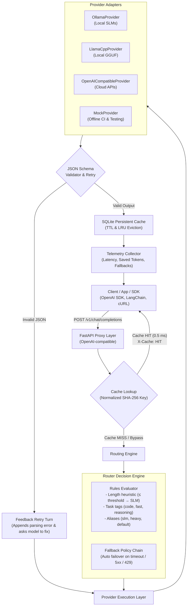

# Local LLM Router & Semantic Cache Proxy

[](https://github.com/DaedricKnight/local-llm-router/actions/workflows/ci.yml)
[](https://www.python.org/downloads/)
[](https://opensource.org/licenses/MIT)
[](https://github.com/astral-sh/ruff)

A lightweight, production-grade CLI utility and Python library that accepts LLM completion requests in a unified OpenAI-compatible format and routes them between local runtimes (**Ollama**, **llama.cpp**) and cloud providers (**OpenAI**, **vLLM**, **Groq**).

Includes built-in **SLM/LLM length-based routing**, **automatic multi-provider fallback chains**, **SQLite caching with TTL and LRU eviction**, **structured JSON Schema auto-repair retry loops**, and **real-time telemetry**.

---

## 🏗 Architecture & Overview



---

## 🎯 Key Capabilities & Why It's Built for High Engineering Standards

* **100% Mockable & Offline Testable**: Ships with an advanced `MockProvider` and pure HTTP transport mocks. No live models or paid API keys required to run the full end-to-end test suite (`pytest tests/`).
* **5 Independent, Decoupled Modules**:
  1. `providers/`: Unified adapter interface for Ollama, llama.cpp, OpenAI-compatible APIs, and mock runtimes.
  2. `router/`: Intelligent routing based on prompt length, task tags, or explicit aliases, backed by resilient fallback chains.
  3. `cache/`: SQLite cache featuring canonical prompt normalization, configurable TTL, and LRU eviction.
  4. `validator/`: JSON Schema validator with automatic multi-turn error correction loops.
  5. `api/`, `cli/`, `telemetry/`: OpenAI-compatible HTTP proxy, rich interactive CLI, and telemetry dashboards.
* **Modern Stack**: Python 3.11+, FastAPI, Typer, Pydantic v2, aiosqlite, jsonschema, httpx, and Rich.

---

## 📦 Project Structure

```
local-llm-router/
├── src/
│   └── local_llm_router/
│       ├── providers/             # Module 1: Provider adapters & BaseProvider
│       │   ├── base.py            # Abstract BaseProvider with token heuristics
│       │   ├── mock.py            # Configurable MockProvider for testing & offline mode
│       │   ├── ollama.py          # Ollama local runtime adapter
│       │   ├── llama_cpp.py       # llama.cpp server adapter
│       │   ├── openai_compatible.py # Generic OpenAI / vLLM / Groq adapter
│       │   └── registry.py        # Provider registry & factory
│       │
│       ├── router/                # Module 2: Routing engine & fallback policies
│       │   ├── rules.py           # Length-based, tag-based, and alias routing
│       │   ├── policies.py        # FallbackChain resolver and recoverability rules
│       │   └── engine.py          # Core RouterEngine orchestrator
│       │
│       ├── cache/                 # Module 3: Persistent SQLite caching
│       │   ├── base.py            # Abstract BaseCache
│       │   ├── key.py             # Deterministic SHA-256 key normalization
│       │   └── sqlite_cache.py    # Async SQLite cache with TTL & LRU eviction
│       │
│       ├── validator/             # Module 4: Structured output & JSON validation
│       │   ├── schema.py          # JSON extractor & jsonschema validator
│       │   └── loop.py            # Auto-correction multi-turn retry loop
│       │
│       ├── telemetry/             # Telemetry & metrics collector
│       │   └── collector.py       # Latencies (p50/p95), tokens saved, fallback stats
│       │
│       ├── api/                   # Module 5: FastAPI HTTP Server
│       │   ├── app.py             # App factory, lifespan lifecycle, OpenAI error formats
│       │   ├── dependencies.py    # Dependency injection helpers
│       │   └── routes.py          # POST /v1/chat/completions, GET /v1/models, /health
│       │
│       └── cli/                   # Typer CLI interface
│           ├── main.py            # Entrypoint (local-llm-router / llm-router)
│           └── commands/          # serve, stats, cache, check, init
│
├── tests/                         # Comprehensive Pytest Suite (32 tests, >85% coverage)
├── router.example.yaml            # Well-documented configuration template
├── Dockerfile & docker-compose.yml
└── pyproject.toml
```

---

## 🚀 Quick Start

### 1. Installation

```bash
# Clone the repository
git clone https://github.com/DaedricKnight/local-llm-router.git
cd local-llm-router

# Install with pip or uv
pip install .
# Or for development with testing tools:
pip install ".[dev]"
```

### 2. Generate Configuration & Check Health

```bash
# Generate starter router.yaml
local-llm-router init

# Verify reachability of configured backends
local-llm-router check
```

### 3. Start the Proxy Server

```bash
local-llm-router serve --host 127.0.0.1 --port 8000 --reload
```

---

## ⚙️ Configuration (`router.yaml`)

```yaml
server:
  host: 127.0.0.1
  port: 8000
  workers: 1
  log_level: info

cache:
  enabled: true
  db_path: data/cache.db
  ttl_seconds: 86400  # 24 hours (0 = infinite)
  max_entries: 10000  # LRU eviction limit
  normalize_whitespace: true

validator:
  enabled: true
  max_retries: 3
  strip_markdown: true

routing:
  default_route: slm
  # Prompts <= 250 tokens go to fast local SLM, > 250 to heavier model
  length_threshold_tokens: 250
  slm_target: ollama:llama3.2:1b
  heavy_target: openai:gpt-4o-mini

  tags:
    fast: slm
    code: ollama:qwen2.5-coder
    reasoning: openai:gpt-4o

  aliases:
    slm: ollama:llama3.2:1b
    heavy: openai:gpt-4o-mini
    default: ollama:llama3.2:1b

  fallback_chains:
    default:
      - ollama:llama3.2:1b
      - openai:gpt-4o-mini
      - mock:fallback

providers:
  - name: ollama
    type: ollama
    base_url: http://localhost:11434
    default_model: llama3.2:1b

  - name: llamacpp
    type: llama_cpp
    base_url: http://localhost:8080
    default_model: local-model

  - name: openai
    type: openai_compatible
    base_url: https://api.openai.com/v1
    api_key: "${OPENAI_API_KEY}"
    default_model: gpt-4o-mini

  - name: mock
    type: mock
    default_model: mock-model
```

---

## 💡 Usage Examples

### Using Official OpenAI Python SDK

Drop `local-llm-router` directly into existing applications by updating `base_url`:

```python
from openai import OpenAI

client = OpenAI(
    base_url="http://127.0.0.1:8000/v1",
    api_key="not-needed-for-local",
)

# 1. Automatic length-based routing:
# Short prompts seamlessly route to local SLM (e.g. Llama 3.2 1B)
response = client.chat.completions.create(
    model="auto",
    messages=[{"role": "user", "content": "Hello! What is 2 + 2?"}],
)
print(response.choices[0].message.content)

# 2. Structured JSON Output with Automatic Retry Loop:
schema = {
    "type": "object",
    "properties": {
        "summary": {"type": "string"},
        "sentiment": {"type": "string", "enum": ["positive", "neutral", "negative"]},
    },
    "required": ["summary", "sentiment"],
}

structured = client.chat.completions.create(
    model="slm",
    messages=[{"role": "user", "content": "Analyze: 'This proxy saves significant time and compute!'"}],
    extra_body={"json_schema": schema},
)
print(structured.choices[0].message.content)
```

### Using cURL

```bash
# Standard chat completion
curl -X POST http://127.0.0.1:8000/v1/chat/completions \
  -H "Content-Type: application/json" \
  -d '{
    "model": "auto",
    "messages": [{"role": "user", "content": "Explain quantum computing in one sentence."}]
  }'

# Bypass cache explicitly
curl -X POST http://127.0.0.1:8000/v1/chat/completions \
  -H "Content-Type: application/json" \
  -H "X-Cache-Bypass: true" \
  -d '{
    "model": "slm",
    "messages": [{"role": "user", "content": "Latest temperature reading"}]
  }'
```

---

## 🖥 CLI Commands Reference

| Command | Description |
|---|---|
| `local-llm-router serve` | Start the FastAPI proxy server (`--host`, `--port`, `--reload`, `--workers`) |
| `local-llm-router stats` | Display live cache hit-rate, latency p50/p95, saved tokens, and failover stats |
| `local-llm-router check` | Check health and responsiveness of configured backends |
| `local-llm-router cache info` | Display SQLite cache file size, item count, and TTL settings |
| `local-llm-router cache clear` | Purge all cached records from the SQLite database |
| `local-llm-router init` | Scaffold a fresh `router.yaml` configuration file |

---

## 🧪 Testing & Verification

The project includes 32 automated tests covering all 5 modules:

```bash
# Run pytest with code coverage report
pytest -v --cov=local_llm_router

# Run Ruff linter
ruff check src/ tests/
```

Test categories:
- `test_providers.py`: MockProvider error injection, OpenAI mock transports, Ollama and llama.cpp health.
- `test_router.py`: Length routing rules, tag routing, alias resolution, and resilient fallback chains.
- `test_cache.py`: Deterministic key hashing, TTL expiration, LRU eviction, and bypass headers.
- `test_validator.py`: JSON parsing from markdown, schema validation, and multi-turn feedback retry loops.
- `test_api.py`: FastAPI endpoints, OpenAI spec compliance, header parsing, and cache invalidation.
- `test_cli.py`: Typer CLI runners for `serve`, `stats`, `check`, `init`, and `cache`.
- `test_end_to_end.py`: Complete scenario testing routing -> caching -> fallback -> telemetry.

---

## 🐳 Docker Deployment

```bash
# Using docker-compose
docker-compose up --build -d

# Check health
curl http://localhost:8000/health
```

---

## 📄 License

MIT License. See [LICENSE](LICENSE) for details.
